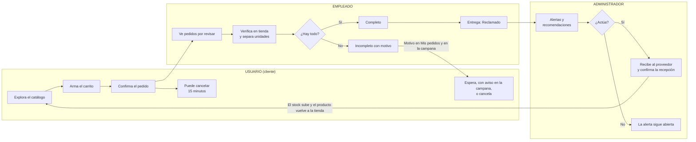

# StockPlan

Sistema web de inventario y pedidos para una tienda de calzado. Su parte innovadora está en el **administrador**: el sistema interpreta los datos de inventario, ventas y pedidos para generarle **alertas y recomendaciones de reposición**, y es él quien decide si actúa o deja la alerta abierta.

Proyecto académico, pensado para ejecutarse en local.

## Recorre la documentación

| Quiero entender… | Documento |
|---|---|
| Cómo se conectan las piezas y qué recorre una petición | [Arquitectura del sistema](docs/arquitectura/sistema.md) |
| Qué pantalla usa qué API y qué tablas toca | [Pantallas, API y tablas](docs/arquitectura/pantallas.md) |
| Todas las rutas de la API, con permisos y parámetros | [Referencia de la API](docs/api/endpoints.md) |
| Las 12 tablas de Oracle y sus relaciones | [Modelo de datos](docs/database/modelo-de-datos.md) |

## Los tres roles



<details>
<summary><strong>El ciclo del administrador, paso a paso</strong></summary>

1. Un producto se queda sin unidades libres: desaparece de la tienda y los clientes no pueden pedirlo.
2. El sistema genera la alerta de **agotado** y **Reposición** recomienda cuánto pedir, a qué proveedor y por qué.
3. El administrador decide. Si no actúa, la alerta sigue abierta; no se puede descartar, solo se cierra cuando el problema se resuelve.
4. El proveedor entrega en físico. El administrador revisa la mercancía y registra la recepción: cantidad **esperada** (la que el proveedor se comprometió a entregar), **recibida** (la que entregó de verdad) y **rechazada** (con su motivo). La **aceptada** es recibida − rechazada.
5. Al **confirmar** la recepción, lo aceptado entra al stock, la alerta y la recomendación se cierran solas y el producto vuelve a la tienda.

</details>

<details>
<summary><strong>Reglas de negocio que sostienen el sistema</strong></summary>

| Regla | Detalle |
|---|---|
| Disponible para el administrador | Stock actual − reservado |
| Disponible en la tienda | Stock actual − reservado − unidades ya pedidas y aún sin separar |
| Reserva | Ocurre cuando el empleado verifica el pedido |
| Cancelación | El cliente, dentro de 15 minutos, o en cualquier momento si su pedido quedó incompleto. El administrador, los pedidos "Sin reclamar" (más de 4 días) y los incompletos, con motivo. El empleado nunca cancela |
| Pedido incompleto | Refleja una diferencia entre el sistema y lo físico; el empleado lo confirma con un motivo. El cliente lo ve y decide: espera, y la campana le avisa cuando esté listo, o lo cancela |
| Sesión | El token dura 30 minutos y se renueva con el uso; 20 minutos sin actividad cierran la sesión |
| Cuenta desactivada | No puede entrar y pierde de inmediato su sesión abierta |

Estas reglas están en el backend, no en la pantalla, salvo el conteo de inactividad, que lleva el navegador.

</details>

## Herramientas

| Capa | Herramienta | Para qué se usa |
|---|---|---|
| Frontend | React 19 | Interfaz |
| | Vite 7 | Servidor de desarrollo y compilación |
| | React Router 7 | Rutas y protección por rol |
| | lucide-react | Íconos |
| | SVG propio | Gráficos de análisis, sin librerías externas |
| Backend | Node.js 20 o superior | Entorno de ejecución |
| | Express 4 | API REST |
| | oracledb 6 (modo Thin) | Conexión a Oracle, sin Instant Client |
| | jsonwebtoken | Sesión con JWT (HS256) |
| | bcrypt | Hash de contraseñas |
| | helmet, cors, express-rate-limit | Seguridad de la API |
| | nodemailer | Correo opcional al cliente |
| | dotenv, nodemon | Configuración y recarga en desarrollo |
| Base de datos | Oracle XE 21c | PDB `XEPDB1`, esquema `STOCKPLAN`, 12 tablas |
| | SQL Developer | Administración de la base |

## Puesta en marcha

**Requisitos:** Node.js 20 o superior y Oracle XE con el esquema de [`database/script/stockplan_schema.sql`](database/script/stockplan_schema.sql).

```bash
# 1. Backend (http://localhost:3000)
cd backend
npm install
cp .env.example .env        # completar la conexión a Oracle y JWT_SECRET
npm run bootstrap:admin     # solo la primera vez: crea el primer administrador
npm run dev

# 2. Frontend, en otra terminal (http://localhost:5173)
cd frontend
npm install
cp .env.example .env        # VITE_API_URL=http://localhost:3000/api
npm run dev
```

Para comprobar el backend: `GET http://localhost:3000/api/health`.

Los archivos `.env` no se suben al repositorio. Los clientes se registran desde la página; los empleados y administradores los crea un administrador en **Personal**.

<details>
<summary><strong>Agregar un producto nuevo</strong></summary>

1. Crear el producto en **Productos**, con su proveedor y sus tallas. El sistema crea una referencia y una fila de inventario por cada talla.
2. Descargar una imagen del zapato y guardarla en `frontend/public/images/products/`, en PNG y con el nombre del producto en minúsculas, sin tildes ni espacios: "Run Falcon" → `runfalcon.png`. Sin ese archivo, la tienda muestra "Sin foto".
3. Registrar y confirmar una recepción. Sin stock, el producto no aparece en la tienda.

</details>

## Estructura

```text
backend/src/
  server.js       arranque: valida la configuración, abre el pool de Oracle y escucha
  app.js          Express: seguridad, CORS y registro de rutas
  routes/         qué URL existe y qué rol la puede usar
  controllers/    valida la petición y arma la respuesta
  services/       reglas de negocio y SQL (los únicos que hablan con Oracle)
  middleware/     autenticación y autorización
  config/oracle.js  pool de conexiones
  utils/          transacciones, validadores y errores
frontend/src/
  routes/         rutas de la interfaz y protección por rol
  layouts/        marco del panel de administrador y de empleado
  pages/          una carpeta por pantalla
  components/     piezas reutilizables
  services/       llamadas a la API y control de la sesión
  data/           datos locales: carrito, módulos y temas del panel
frontend/public/images/products/   imágenes de los productos
database/script/stockplan_schema.sql   tablas, índices y roles iniciales
docs/             documentación detallada
```

`pom.xml` es un resto de una plantilla Java: el proyecto no lo usa. `CLAUDE.md` y `.claude/` son configuración de una herramienta de desarrollo.
