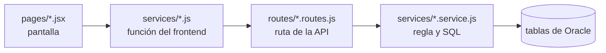

# Pantallas, API y tablas

[← Volver al README](../../README.md)

Cada fila une una pantalla con su función del frontend, la ruta de la API y las tablas que toca. El prefijo `/api` se omite en las rutas. El detalle está en la [referencia de la API](../api/endpoints.md) y en el [modelo de datos](../database/modelo-de-datos.md).

<strong>Cliente (USUARIO)</strong>

| Pantalla (ruta) | Función del frontend | API | Tablas |
|---|---|---|---|
| Inicio y catálogo (`/`) | `store.getStoreProducts` | `GET /store/productos` | PRODUCTOS, REFERENCIA_PRODUCTO, INVENTARIO, DETALLE_PEDIDO, PEDIDO |
| Detalle (`/productos/:id`) | `store.getStoreProduct` | `GET /store/productos/:id` | Las anteriores y TALLA |
| Registro (`/registro`) | `auth.registerRequest` | `POST /auth/register` | USUARIO, ROL |
| Login (`/login`) | `auth.loginRequest` | `POST /auth/login` | USUARIO, ROL |
| Carrito (`/carrito`) | `orders.createOrder` | `POST /pedidos` | INVENTARIO, PRODUCTOS, PEDIDO, DETALLE_PEDIDO |
| Mis pedidos (`/mis-pedidos`) | `orders.getMyOrders` | `GET /pedidos` | PEDIDO, DETALLE_PEDIDO, PROCESO_PEDIDO |
| Cancelar pedido | `orders.cancelMyOrder` | `POST /pedidos/:id/cancelar` | PEDIDO, DETALLE_PEDIDO, INVENTARIO, PROCESO_PEDIDO |
| Campana de avisos | `orders.getMyNotifications` | `GET /pedidos/notificaciones` | PROCESO_PEDIDO, PEDIDO |

El carrito se guarda en el navegador (`data/shoppingCart.js`) y solo llega a Oracle al confirmar el pedido.

<strong>Empleado</strong>

| Pantalla (ruta) | Función del frontend | API | Tablas |
|---|---|---|---|
| Pedidos por revisar (`/empleado`) | `employeeOrders.getEmployeeOrders`, `getOrdersSummary` | `GET /empleado/pedidos`, `GET /empleado/pedidos/resumen` | PEDIDO, USUARIO, DETALLE_PEDIDO |
| Pedidos completos (`/empleado/pedidos/completos`) | `getEmployeeOrders` | `GET /empleado/pedidos?estado=...` | Las mismas |
| Detalle (`/empleado/pedidos/:id`) | `getEmployeeOrder` | `GET /empleado/pedidos/:id` | Además INVENTARIO y PROCESO_PEDIDO |
| Verificado y separado | `verifyEmployeeOrder` | `POST /empleado/pedidos/:id/verificar` | PEDIDO, DETALLE_PEDIDO, INVENTARIO, PROCESO_PEDIDO |
| Marcar como reclamado | `deliverEmployeeOrder` | `POST /empleado/pedidos/:id/entregar` | Las mismas y MOVIMIENTO_INVENTARIO |

<strong>Administrador: operación</strong>

| Pantalla (ruta en `/administrador`) | Función del frontend | API | Tablas |
|---|---|---|---|
| Productos (`/productos`) | `admin.getProducts`, `createProduct` | `GET`, `POST /admin/productos` | PRODUCTOS, REFERENCIA_PRODUCTO, INVENTARIO, PROVEEDOR, TALLA |
| Detalle de producto (`/productos/:id`) | `getProduct`, `updateProduct`, `setProductStatus`, `addProductSize`, `setProductSizeStatus` | `/admin/productos/:id...` | Las mismas |
| Proveedores y tallas (`/catalogo`) | `getSuppliers`, `createSupplier`, `updateSupplier`, `getSizes`, `createSize` | `/admin/proveedores`, `/admin/tallas` | PROVEEDOR, TALLA |
| Recepciones (`/recepciones`) | `getReceptions`, `createReception`, `confirmReception`, `cancelReception` | `/admin/recepciones...` | RECEPCION, INVENTARIO, MOVIMIENTO_INVENTARIO |
| Stock (`/inventario`) | `getInventory`, `setInventoryMinimum`, `adjustInventory` | `/admin/inventario...` | INVENTARIO, MOVIMIENTO_INVENTARIO |
| Movimientos (`/movimientos`) | `getMovements` | `GET /admin/movimientos` | MOVIMIENTO_INVENTARIO, USUARIO |
| Pedidos (`/pedidos`) | `adminOrders.getAdminOrders`, `getAdminOrder`, `getClaimedValue`, `cancelUnclaimedOrder`, `cancelIncompleteOrder` | `/admin/pedidos...` | PEDIDO, DETALLE_PEDIDO, PROCESO_PEDIDO, INVENTARIO |
| Personal (`/usuarios`) | `auth.getStaffAccounts`, `createStaffAccount`, `setStaffStatus` | `/admin/staff...` | USUARIO, ROL |

<strong>Administrador: análisis, la parte innovadora</strong>

| Pantalla (ruta en `/administrador`) | Función del frontend | API | Qué responde |
|---|---|---|---|
| Reposición (`/reposicion`) | `adminInsights.getReplenishment` | `GET /admin/analisis/reposicion` | Qué pedir, cuánto, a quién y hasta cuándo |
| Comportamiento (`/comportamiento`) | `getBehavior` | `GET /admin/analisis/comportamiento` | Entradas, salidas, rotación y cuándo se agota cada producto |
| Ventas y recomendaciones (`/ventas`) | `getSales` | `GET /admin/analisis/ventas` | Ventas reales, proyección y recomendaciones de compra |
| Alertas (`/alertas`) y campana | `getAlerts` | `GET /admin/analisis/alertas` | Lo que requiere atención |

Estas pantallas solo leen: combinan INVENTARIO, MOVIMIENTO_INVENTARIO, RECEPCION, PEDIDO, DETALLE_PEDIDO y PROCESO_PEDIDO, y no guardan nada.

<strong>Sesión, en todos los roles</strong>

| Pieza | Qué hace | API |
|---|---|---|
| `routes/ProtectedRoute.jsx` | Comprueba la sesión y el rol antes de mostrar una zona privada | `GET /auth/me` |
| `services/session.js` | Registra la actividad, renueva el token y cierra a los 20 minutos de inactividad | `POST /auth/renovar` |
| `services/session.js` | Ante una respuesta 401 con sesión abierta, lleva al login con el motivo | Cualquiera |

