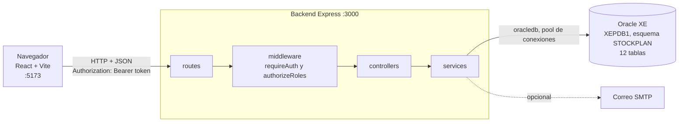
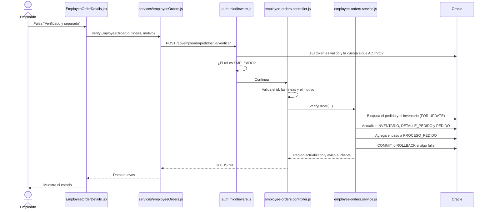
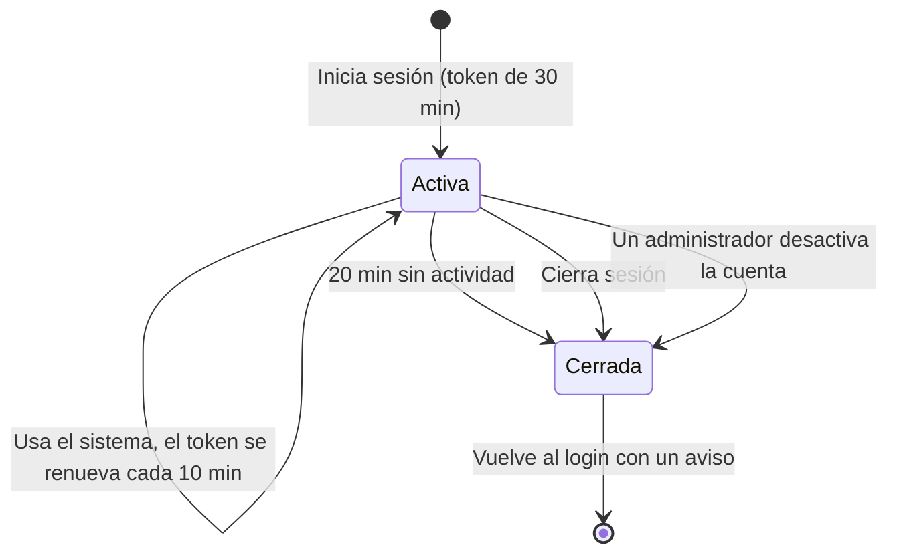

# Arquitectura del sistema

[← Volver al README](../../README.md)

## Vista general

El navegador nunca habla con Oracle ni conoce sus credenciales: solo llama a la API. Dentro del backend, **solo los servicios ejecutan SQL**.

## Qué recorre una petición

Ejemplo: el empleado verifica un pedido.

<strong>Qué hace cada capa del backend</strong>

| Capa | Archivos | Responsabilidad |
|---|---|---|
| Arranque | `server.js`, `config/oracle.js` | Valida `JWT_SECRET`, abre el pool y atiende el cierre ordenado |
| Aplicación | `app.js` | `helmet`, CORS, JSON de hasta 10 kB, rutas y manejo de errores |
| Rutas | `routes/*.routes.js` | Declaran la URL y exigen el rol |
| Middleware | `middleware/auth.middleware.js` | Comprueba el token y que la cuenta siga activa, y autoriza por rol |
| Controladores | `controllers/*.controller.js` | Validan la entrada con `utils/validators.js` y responden |
| Servicios | `services/*.service.js` | Reglas de negocio y SQL |
| Utilidades | `utils/db.js` | `withConnection` para lecturas y `withTransaction` para escrituras: todo o nada |

<strong>Cómo se conecta con Oracle</strong>

1. `backend/.env` define `DB_CONNECT_STRING`, `DB_USER` y `DB_PASSWORD`.
2. Al arrancar, `config/oracle.js` crea un **pool** con `oracledb` en modo Thin, sin instalar Oracle Instant Client.
3. Cada operación pide una conexión al pool y la devuelve al terminar.
4. Las escrituras usan `withTransaction`: si cualquier paso falla, se revierte todo. Por eso no pueden quedar reservas o stock a medias.
5. Los valores siempre viajan como parámetros (`:id`), nunca concatenados, lo que evita la inyección SQL.

## Seguridad y sesión

| Tema | Cómo se resuelve | Dónde |
|---|---|---|
| Contraseñas | Hash bcrypt, nunca en texto plano | `users.service.js` |
| Contraseña nueva y correo | 8 caracteres o más con mayúscula, minúscula, número y símbolo; correo `texto@dominio.ext`. Se valida en el navegador y otra vez en el backend | `utils/credentials.js`, `frontend/src/utils/validation.js` |
| Identidad | JWT HS256 de 30 minutos, con emisor y audiencia | `auth.service.js` |
| Inactividad | El navegador registra la actividad, renueva el token y cierra a los 20 minutos | `frontend/src/services/session.js` |
| Cuenta desactivada | Cada petición consulta `USUARIO.ESTADO`, así que pierde el acceso de inmediato | `auth.middleware.js` |
| Permisos | Cada grupo de rutas exige su rol en el backend | `routes/` |
| Intentos | Login: 10 cada 15 minutos. Registro: 5 por hora. Altas de personal: 20 por hora, por IP | `auth.routes.js`, `staff.routes.js` |
| Orígenes | Solo los definidos en `FRONTEND_ORIGIN` | `app.js` |
| Precios | Se toman de la base, nunca del navegador | `orders.service.js` |

La protección de rutas en React solo organiza la interfaz; la seguridad real está en el backend.

Como este es un proyecto académico, no hay recuperación de contraseña: si se olvida, un administrador tendría que crear otra cuenta.

## Cómo se calculan las recomendaciones

Nada de esto se guarda: se calcula en `insights.service.js` cada vez que se consulta, así que los productos nuevos aparecen solos.

| Dato | Fórmula |
|---|---|
| Consumo diario | Unidades entregadas en el periodo ÷ días del periodo (90 por defecto) |
| Disponible | Stock actual − reservado |
| Proyectado | Disponible − pedido sin separar + recibido sin confirmar |
| Punto de reorden | El mayor entre el stock mínimo y consumo × (días de entrega + 2 de seguridad) |
| Sugerido | Consumo × el mayor entre horizonte y días de entrega + stock mínimo − proyectado |
| Se agota | Hoy + disponible ÷ consumo diario |
| Pedir antes de | Fecha de agotamiento − días de entrega |

| Urgencia | Cuándo |
|---|---|
| Crítica | No hay disponible, o alcanza menos días que la entrega del proveedor |
| Alta | Está bajo el stock mínimo o en el punto de reorden |
| Normal | El resto |

<strong>Alertas que genera el sistema</strong>

| Alerta | Se activa cuando | Severidad | "Revisar" lleva a |
|---|---|---|---|
| Referencia agotada | Disponible en 0 o menos | Crítica | Reposición |
| Por reponer | Urgencia crítica o alta, con algo disponible | Alta o media | Reposición |
| Pedido sin verificar | Pendiente, más de 30 min después de la ventana de cancelación | Alta | Pedidos |
| Incompleto que ya se puede completar | Ya hay stock libre para lo que faltaba | Alta | Pedidos |
| Recepción sin confirmar | Registrada hace más de 2 días | Media | Recepciones |
| Pedido sin reclamar | Completo hace más de 4 días | Media | Pedidos |
| Sin ventas | Tiene stock y no se vendió en el periodo | Informativa | Comportamiento |

Cada alerta se cierra sola cuando el problema se resuelve.

