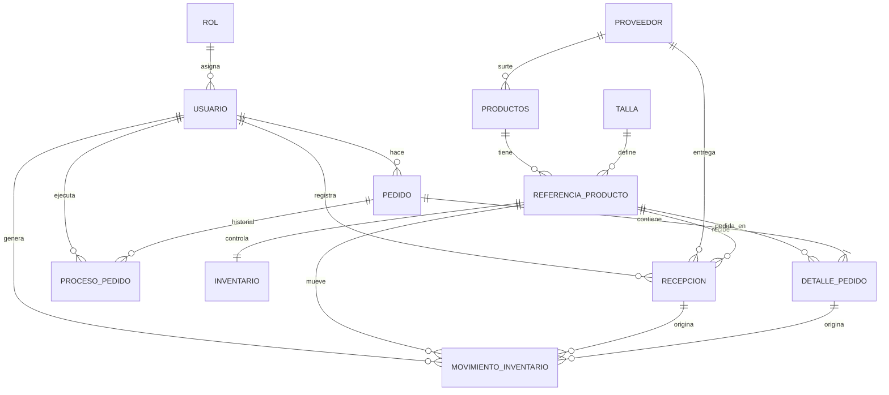
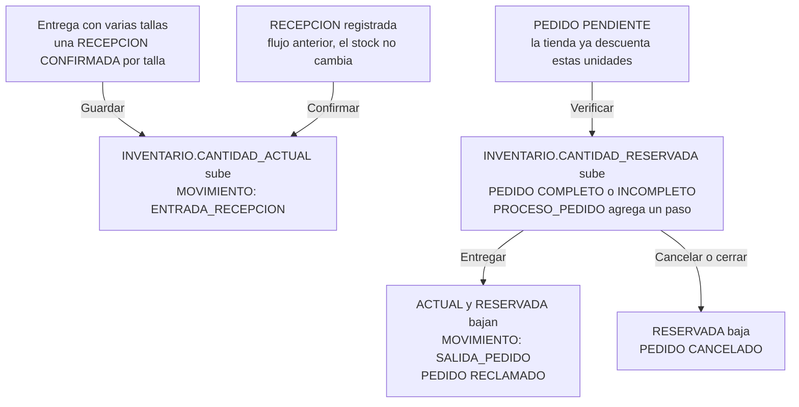

# Modelo de datos

[← Volver al README](../../README.md)

Oracle XE 21c, PDB `XEPDB1`, esquema `STOCKPLAN`, **12 tablas**. El script completo está en [`database/script/stockplan_schema.sql`](../../database/script/stockplan_schema.sql). Las claves primarias son identidades que genera Oracle.

## Relaciones



**La idea central:** una **referencia** es un producto en una talla, por ejemplo Run Falcon talla 40. El inventario, los pedidos y los movimientos trabajan por referencia, no por producto.

## Cómo cambian los datos



## Tablas

<details open>
<summary><strong>Personas: ROL y USUARIO</strong></summary>

**ROL:** los tres roles del sistema.

| Columna | Tipo | Notas |
|---|---|---|
| `ID_ROL_PK` | NUMBER | Clave primaria |
| `NOMBRE_ROL` | VARCHAR2(50) | `ADMINISTRADOR`, `EMPLEADO` o `USUARIO`; único |
| `DESCRIPCION` | VARCHAR2(100) | Opcional |

**USUARIO:** todas las cuentas.

| Columna | Tipo | Notas |
|---|---|---|
| `ID_USUARIO_PK` | NUMBER | Clave primaria |
| `NOMBRE_US`, `APELLIDO_US` | VARCHAR2(50) | Obligatorios |
| `EMAIL` | VARCHAR2(100) | Único; se guarda en minúsculas |
| `PASSWORD_HASH` | VARCHAR2(255) | Hash bcrypt |
| `ESTADO` | VARCHAR2(20) | `ACTIVO` o `INACTIVO`. Cada petición lo comprueba |
| `ID_ROL_FK` | NUMBER | Referencia a ROL |

</details>

<details>
<summary><strong>Catálogo: PROVEEDOR, PRODUCTOS, TALLA y REFERENCIA_PRODUCTO</strong></summary>

**PROVEEDOR**

| Columna | Tipo | Notas |
|---|---|---|
| `ID_PROVEEDOR_PK` | NUMBER | Clave primaria |
| `NOMBRE_PROVEEDOR` | VARCHAR2(100) | Obligatorio |
| `APELLIDO_PROVEEDOR` | VARCHAR2(50) | Opcional |
| `TELEFONO_PROVEEDOR` | VARCHAR2(30) | Opcional |
| `DIAS_ENTREGA` | NUMBER(3) | Por defecto 7; alimenta Reposición |
| `ESTADO` | VARCHAR2(20) | `ACTIVO` o `INACTIVO` |

**PRODUCTOS**

| Columna | Tipo | Notas |
|---|---|---|
| `ID_PRODUCTO_PK` | NUMBER | Clave primaria |
| `NOMBRE_PRODUCTO` | VARCHAR2(100) | También define el nombre de su imagen |
| `DESCRIPCION_PRODUCTO` | VARCHAR2(500) | Opcional |
| `PRECIO` | NUMBER(12,2) | No negativo |
| `ID_PROVEEDOR_FK` | NUMBER | Referencia a PROVEEDOR |
| `ESTADO` | VARCHAR2(20) | `ACTIVO` o `INACTIVO` |

**TALLA**

| Columna | Tipo | Notas |
|---|---|---|
| `ID_TALLA_PK` | NUMBER | Clave primaria |
| `NOMBRE_TALLA` | VARCHAR2(20) | Único |

**REFERENCIA_PRODUCTO:** un producto en una talla.

| Columna | Tipo | Notas |
|---|---|---|
| `ID_REFERENCIA_PK` | NUMBER | Clave primaria |
| `ID_PRODUCTO_FK`, `ID_TALLA_FK` | NUMBER | La pareja es única |
| `ESTADO` | VARCHAR2(20) | `ACTIVO` o `INACTIVO` |

</details>

<details>
<summary><strong>Stock: INVENTARIO, RECEPCION y MOVIMIENTO_INVENTARIO</strong></summary>

**INVENTARIO:** una fila por referencia.

| Columna | Tipo | Notas |
|---|---|---|
| `ID_INVENTARIO_PK` | NUMBER | Clave primaria |
| `ID_REFERENCIA_FK` | NUMBER | Único |
| `CANTIDAD_ACTUAL` | NUMBER(10) | Unidades físicas; no negativa |
| `CANTIDAD_RESERVADA` | NUMBER(10) | Separadas para pedidos; nunca mayor que la actual |
| `STOCK_MINIMO` | NUMBER(10) | Lo fija el administrador |
| `FECHA_ACTUALIZACION` | DATE | Último cambio |

**RECEPCION:** la entrega física del proveedor.

| Columna | Tipo | Notas |
|---|---|---|
| `ID_RECEPCION_PK` | NUMBER | Clave primaria |
| `ID_PROVEEDOR_FK`, `ID_REFERENCIA_FK`, `ID_USUARIO_FK` | NUMBER | Proveedor, referencia y quién la registró |
| `FECHA_INGRESO` | DATE | Fecha de registro |
| `CANTIDAD_ESPERADA` | NUMBER(10) | Lo que el proveedor se comprometió a entregar |
| `CANTIDAD_RECIBIDA` | NUMBER(10) | Lo que entregó de verdad |
| `CANTIDAD_ACEPTADA` | NUMBER(10) | Recibida − rechazada; es lo que entra al stock |
| `CANTIDAD_RECHAZADA` | NUMBER(10) | Lo que no cumplió la revisión |
| `MOTIVO_RECHAZO` | VARCHAR2(200) | Obligatorio si hay rechazo |
| `ESTADO` | VARCHAR2(20) | `REGISTRADA`, `CONFIRMADA` o `ANULADA` |
| `OBSERVACION` | VARCHAR2(500) | Opcional |

La base exige que recibida = aceptada + rechazada.

**MOVIMIENTO_INVENTARIO:** la trazabilidad de todo cambio de stock.

| Columna | Tipo | Notas |
|---|---|---|
| `ID_MOVIMIENTO_PK` | NUMBER | Clave primaria |
| `ID_REFERENCIA_FK` | NUMBER | Referencia afectada |
| `TIPO` | VARCHAR2(30) | `ENTRADA_RECEPCION`, `SALIDA_PEDIDO` o `AJUSTE` |
| `CANTIDAD` | NUMBER(10) | Positiva si entra, negativa si sale |
| `FECHA` | DATE | Momento del movimiento |
| `ID_USUARIO_FK` | NUMBER | Quién lo hizo |
| `ID_RECEPCION_FK`, `ID_DETALLE_PEDIDO_FK` | NUMBER | Origen, si aplica |
| `OBSERVACION` | VARCHAR2(500) | Motivo o detalle |

</details>

<details>
<summary><strong>Pedidos: PEDIDO, DETALLE_PEDIDO y PROCESO_PEDIDO</strong></summary>

**PEDIDO**

| Columna | Tipo | Notas |
|---|---|---|
| `ID_PEDIDO_PK` | NUMBER | Clave primaria; se muestra como `SP-0001` |
| `ID_USUARIO_FK` | NUMBER | Cliente |
| `FECHA_PEDIDO`, `FECHA_ENTREGA` | DATE | La entrega solo existe si fue reclamado |
| `ESTADO` | VARCHAR2(20) | `PENDIENTE`, `INCOMPLETO`, `COMPLETO`, `RECLAMADO` o `CANCELADO` |

**DETALLE_PEDIDO:** una línea por referencia.

| Columna | Tipo | Notas |
|---|---|---|
| `ID_DETALLE_PEDIDO_PK` | NUMBER | Clave primaria |
| `ID_PEDIDO_FK`, `ID_REFERENCIA_FK` | NUMBER | La pareja es única |
| `CANTIDAD_PEDIDO` | NUMBER(10) | Lo que pidió el cliente |
| `CANTIDAD_DISPONIBLE` | NUMBER(10) | Lo que el empleado confirmó y separó |
| `PRECIO_UNITARIO` | NUMBER(12,2) | Precio guardado al momento del pedido |

**PROCESO_PEDIDO:** el historial de quién hizo qué. También alimenta los avisos al cliente.

| Columna | Tipo | Notas |
|---|---|---|
| `ID_PROCESO_PEDIDO_PK` | NUMBER | Clave primaria |
| `ID_PEDIDO_FK`, `ID_USUARIO_FK` | NUMBER | Pedido y quién actuó |
| `ESTADO` | VARCHAR2(20) | Estado que quedó |
| `FECHA` | DATE | Momento |
| `OBSERVACION` | VARCHAR2(500) | Motivo, si aplica |

</details>

<details>
<summary><strong>Consultas útiles en SQL Developer</strong></summary>

```sql
-- Stock de cada referencia, con lo que se ofrece en la tienda
SELECT P.NOMBRE_PRODUCTO, T.NOMBRE_TALLA, I.CANTIDAD_ACTUAL, I.CANTIDAD_RESERVADA,
       I.CANTIDAD_ACTUAL - I.CANTIDAD_RESERVADA
         - NVL((SELECT SUM(D.CANTIDAD_PEDIDO - D.CANTIDAD_DISPONIBLE)
                  FROM DETALLE_PEDIDO D
                  JOIN PEDIDO PE ON PE.ID_PEDIDO_PK = D.ID_PEDIDO_FK
                 WHERE D.ID_REFERENCIA_FK = I.ID_REFERENCIA_FK
                   AND PE.ESTADO IN ('PENDIENTE', 'INCOMPLETO')), 0) AS EN_TIENDA
  FROM INVENTARIO I
  JOIN REFERENCIA_PRODUCTO R ON R.ID_REFERENCIA_PK = I.ID_REFERENCIA_FK
  JOIN PRODUCTOS P ON P.ID_PRODUCTO_PK = R.ID_PRODUCTO_FK
  JOIN TALLA T ON T.ID_TALLA_PK = R.ID_TALLA_FK
 ORDER BY P.NOMBRE_PRODUCTO, T.NOMBRE_TALLA;

-- Historial de un pedido
SELECT H.FECHA, H.ESTADO, U.NOMBRE_US, H.OBSERVACION
  FROM PROCESO_PEDIDO H
  JOIN USUARIO U ON U.ID_USUARIO_PK = H.ID_USUARIO_FK
 WHERE H.ID_PEDIDO_FK = :pedido
 ORDER BY H.FECHA;
```

</details>
